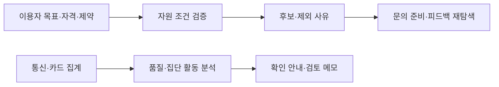

# 첫연결 — 조건에 맞는 지역 지원의 첫 행동 준비

**이용자의 자격·비용·참여 방식을 확인하고, 가능한 지역 자원과 문의 준비를 연결하는 규칙 기반 프로토타입입니다.**

2026 빅콘테스트 AI데이터 활용 분야 · 팀 티미 · Python / HTML / CSS / JavaScript

**본인 기여:** 팀 프로젝트의 구현·분석·실험 및 결과 정리 전반을 주도했습니다.

## 해결하려는 문제

지원 정보가 있어도 나이, 가구 형태, 비용, 회원 조건, 모집기간과 신청 방식이 맞지 않으면 이용으로 이어지기 어렵습니다. 강남구·춘천시의 공식 공개 자료를 바탕으로 조건을 대조하고, 불명확한 내용은 확인 질문으로 남기며, 피드백을 반영해 다시 탐색하도록 구현했습니다.

## 두 가지 처리 흐름



현재 추천 후보는 개인 조건으로 결정합니다. 집단 활동 분석은 확인 안내·검토 메모에 연결되며, 후보나 추천 점수를 변경하지 않습니다. 실제 LLM API 호출·품질과 사회적 고립 위험별 추천은 검증 전입니다.

## 구현과 검증 근거

| 항목 | 확인한 내용 |
|---|---|
| 조건 검증 | 연령·가구·비용·자격·모집기간·신청 및 참여 방식 확인 |
| 의도 유지 | 정보만 보기 선택 시 문의 문안·신청 링크를 비움 |
| 데이터 품질 | 추가 통신 원본 1,505,423행 중 12월 두 파일의 동일 추가행 213,812행 확인 |
| 기능 비교 | 개발자 작성 합성 12사례에서 조건 위반 후보 포함 사례 10/12 → 0/12 |
| 기존 검증 기록 | v0.10 앱·HTTP·오프라인 139개, 분석 27개 통과 기록 |

합성 12사례의 기준선은 태그·지역 중심으로 자격 검사가 부족한 단순 비교군입니다. 해당 결과를 실사용자 추천 품질이나 다른 서비스·LLM 대비 우월성으로 해석하지 않습니다. 테스트 수는 제출 자료의 기존 기록이며 이번 문서 정리에서 재실행한 결과가 아닙니다.

## 공개 코드 실행

공개본에는 규칙 엔진·분석 코드와 **전부 가상으로 작성한 CLI 예제**가 있습니다. Python 3.10 이상, 별도 라이브러리나 API 키 없이 실행합니다.

```bash
python3 examples/synthetic_demo.py
python3 -m unittest discover -s tests -v
```

예제는 무료·온라인 프로그램만 후보에 남고 유료·전화 전용 프로그램이 제외되는지 확인합니다. 실제 기관 정보나 고립 개선 효과를 평가하는 예제가 아닙니다.

[조건 검증 엔진](first_connection/engine.py) · [제약 해석](first_connection/clarify.py) · [집단 활동 분석](analysis/activity_model.py) · [출처 기록](docs/SOURCE_SNAPSHOT.json)

원래 웹 앱의 `app.py`, `static/`도 보존했습니다. 실제 자료용 앱 실행에는 별도로 준비한 원문·카탈로그·분석 결과가 필요합니다. 대회 통신·카드 원본과 제3자 공고 원문은 공개 저장소에 포함하지 않았습니다.

## 한계와 다음 검증

통신·카드 집계의 변화는 개인 고립 확률이 아닙니다. 사회적 고립의 정답·인과 원인·지원 우선순위·실제 참여 효과는 검증하지 않았습니다. 기관 연락·접수·예약은 실행하지 않았고, 가상 자원 시연은 실제 모집 정보와 구분했습니다.

다음 과제는 독립된 새 기간의 분석, 검증된 관계망 측정과의 연결, 활동 판단을 후보 선택에 반영하는 방식 및 이용자·기관과의 평가입니다.

출처: 「AI데이터활용분야_티미_제출물」, 「발표노트_상세근거_v6」.
